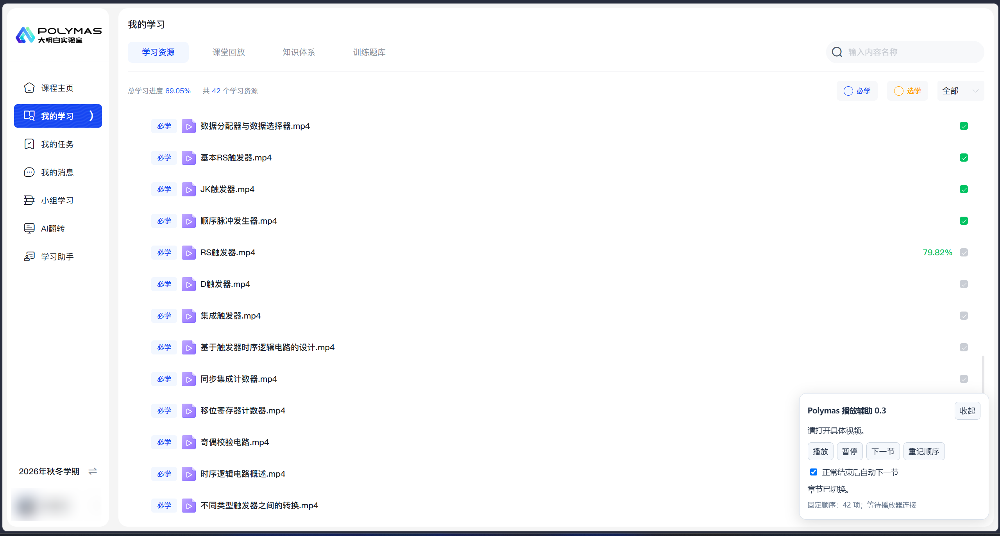
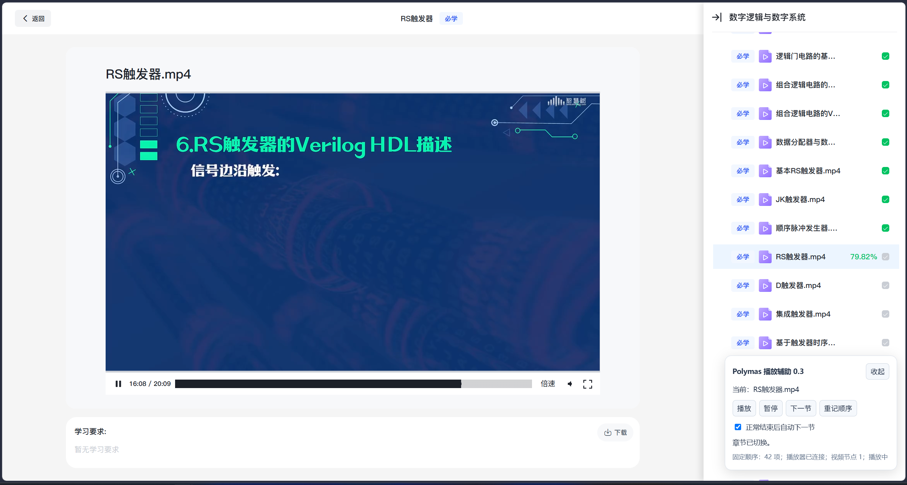

# Polymas 课程播放辅助

这是一个适用于智慧树旗下的 Polymas 新版 AI 教学中心的独立 Tampermonkey（油猴）脚本。  
**解放你的双手，无需再等视频结束才手动切换视频！**

## 功能

- 播放、暂停课程视频。
- 手动或自动切换下一节视频。
- 通过 `data-key` 记录章节顺序，减少页面列表重排对切换结果的影响。
- 支持课程页面与跨域播放器 iframe 之间通信。
- 显示播放器连接状态及视频节点数量。
- 支持收起控制面板。

## 适用页面

## 运行截图

脚本依赖当前网站的页面结构。网站更新后，可能需要调整选择器或通信逻辑。

## 安装

1. 在浏览器中安装 Tampermonkey 扩展。
2. [然后点此安装这个脚本](https://raw.githubusercontent.com/FGFRN/Polymas-PlaybackAssistance/main/polymas-helper.user.js)
4. 刷新课程页面，打开一个视频。
5. 确认页面右下角出现“Polymas 播放辅助”面板。

>请只启用一个版本的本脚本。如果同时使用其他课程辅助脚本，建议关闭其自动播放和章节切换功能，避免相互干扰。

## 使用

建议先验证手动功能，再启用连续播放：

1. 打开一个课程视频，等待面板显示“播放器已连接”。
2. 测试“播放”和“暂停”。
3. 点击“下一节”，确认目标章节正确。
4. 需要连续播放时，勾选“正常结束后自动下一节”。

> **注意！播放过程中如果将窗口最小化或覆盖可能导致视频暂停！**

点击“暂停”会同时关闭连续播放。

自动切换由视频真实的 `ended` 事件触发，等待约 3 秒后执行。遇到无法识别的资源类型、章节缺失或切换超时等情况时，脚本会停止自动处理并显示提示。

## 章节顺序

脚本首次读取章节列表时，会保存当时的资源顺序。之后按保存的 `data-key` 查找目标章节，不再直接使用页面当前的排列顺序。

- 顺序保存在当前网站的 `sessionStorage` 中，按课程区分。
- 同一标签页刷新后通常仍可保留。
- 点击“重记顺序”会使用页面当前列表重新记录。
- 保存的顺序不保证是教师设定的原始顺序。
- 如果列表尚未完整加载，记录结果可能不完整。

需要重记时，请先确认页面资源已加载，且排列符合预期。

## 工作原理

脚本分别运行在课程页面和播放器页面：

- **课程页面**读取章节列表、识别当前章节，并提供控制面板。
- **播放器页面**查找原生 HTML5 `<video>`，执行播放、暂停并监听播放结束事件。
- 两个页面通过 `postMessage` 交换控制指令和状态。

消息接收时会检查来源域名、来源窗口、消息标识及资源 `fileId`，避免误处理其他窗口或旧资源的消息。

## 数据与权限

- 不引入外部 JavaScript 依赖。
- 不使用题库或 AI 服务。
- 不主动读取 Cookie、密码或登录凭据。
- 不新增向外部服务器发送数据的请求。
- 仅在匹配的课程页与播放器页之间传递控制指令和播放器状态。
- 本地保存章节标识与标题，用于维持切换顺序。

课程网站和播放器自身的网络请求、学习记录上报等行为仍由网站处理。

## 限制

- **无法切换倍速！因为有可能导致视频学习进度出错。这不是脚本的问题，可能是平台的局限性。**
- 不识别或跳过已完成章节。
- 不提供自动答题或作业提交功能。
- 不伪造学习时长、完成状态或进度上报。
- 视频播放结束不代表服务器已经确认学习完成。
- 浏览器的自动播放限制可能要求用户手动点击视频。
- 折叠、延迟加载或虚拟滚动的章节列表可能导致资源读取不完整。
- 自动模式目前按文件名后缀识别视频，可能无法识别未带视频扩展名的资源。

当前版本基于特定页面结构开发，兼容性仍需在不同课程和浏览器环境中验证。

## 常见问题

### 一直显示“等待播放器连接”

确认：

- 已保存最新脚本，并刷新整个课程页面。
- Tampermonkey 已启用本脚本。
- 脚本匹配范围同时包含课程页和 `polymas.com` 播放器页。
- 实际播放器地址未发生变化。

### 播放指令已发送，但视频没有开始

浏览器可能阻止了自动播放。先手动点击一次视频画面，再测试面板按钮。

### 下一节顺序不符合预期

脚本使用首次记录的顺序。确认列表加载完整且排序正确后，点击“重记顺序”。

### 提示目标章节未加载

尝试展开章节目录或滚动列表，使目标资源加载出来，再操作。当前版本不会主动加载未出现在页面中的章节。

## 问题反馈

提交 Issue 时，请提供：

- 浏览器及 Tampermonkey 版本。
- 脚本版本。
- 复现步骤与预期行为。
- 面板中的完整提示。
- 必要时提供相关节点的小段 HTML。

请勿上传账号密码、Cookie、令牌或包含敏感查询参数的完整链接。

## 声明

本项目为非官方学习辅助工具，与 Polymas、智慧树及其他相关平台不存在隶属或合作关系。

请在有权访问的课程中使用，并遵守所在学校及课程平台的使用要求。
